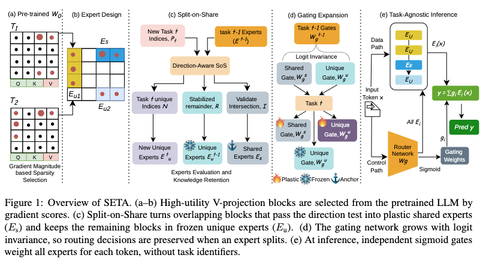

# SETA: Continual Learning for LLMs with Split-on-Share Experts

<p align="center">
  
</p>
<p align="center"><em>Overview of SETA.</em></p>

SETA is a continual-learning method for large language models. The model
learns a stream of tasks one after another and should keep its accuracy on
earlier tasks without replaying their data. SETA adds a sparse
mixture-of-experts (MoE) layer on top of a frozen base model. Each expert is a
small set of weight blocks, and a router decides how much each expert
contributes to a given input.

## Method

For each new task, SETA runs four stages:

1. **Block selection.** A short full fine-tuning warm-up scores every weight
   block by the gradient it receives. The highest-scoring blocks, up to a fixed
   budget, become the new task's candidate blocks.
2. **Split-on-Share.** Some candidate blocks already belong to experts from
   earlier tasks. For each of these blocks, SETA tests whether the new task's
   gradient points in the same direction as the update the old expert already
   made. The test compares the two against the agreement expected by chance.
   - If they agree, the block becomes part of a *shared* expert, so related
     tasks reuse what was already learned.
   - If they disagree, the old expert keeps the block frozen and the new task
     gets its *own copy* of it, so the new update cannot overwrite the old one.
3. **Training.** Only the new task's experts and its router rows are trained.
   Router rows of earlier experts stay frozen, and the new task's own copies are
   trained orthogonally to the old expert's update.
4. **Evaluation.** After each task, the model is evaluated on that task. At the
   end of the stream, it is evaluated on all earlier tasks.

Splitting only where the gradients disagree lets tasks share capacity when they
are related and keeps them apart when they conflict. This avoids both forgetting
caused by blind weight sharing and the cost of a new full adapter per task.

## Installation

```bash
git clone <this repository>
cd Split-on-Share
pip install torch transformers trl datasets accelerate huggingface_hub \
            scikit-learn pandas evaluate nltk psutil
```

The experiments ran on a single 80 GB A100 GPU. Base models are
loaded from local Hugging Face checkpoints (one folder per model, set with
`MODEL_ROOT`).

## Data

Experiments use the [TRACE](https://github.com/BeyonderXX/TRACE) continual-learning
benchmark and the standard continual-learning classification tasks used by
O-LoRA (Wang et al., 2023). Point `DATA_ROOT` to the folder that holds the
benchmark splits.

## Quick start

Each launcher submits one Slurm job that trains a whole task stream, evaluates
the final model on every earlier task, and reports the continual-learning
metrics.

```bash
# TRACE, 8 tasks
bash scripts/run_setafix_order.sh 1-8 fft,split,train,eval qwen3_4b

# O-LoRA task orders (orders 1-3: 4 tasks, orders 4-6: 15 tasks)
OLORA_ORDER="1 2 3 4 5 6" bash scripts/run_sos_olora.sh

# Math stream (ScienceQA -> NumGLUE-cm -> NumGLUE-ds)
bash scripts/run_sos_mathllm.sh all fft,split,train,eval llama2_7b
```

Every launcher takes a task range, the steps to run and the model name, and
accepts several seeds through `SEED`, for example `SEED="100 42 7"`. The paper's
settings are the defaults, so no other options are needed to reproduce the main
results. If a job is interrupted, rerun the same command with
`FORCE_OVERWRITE=True`; tasks that already finished are skipped.

The paper uses Qwen3-4B, LLaMA-2-7B and LLaMA-3-8B; the code also accepts
Qwen3-8B and Qwen3-14B.

## Reproducing the paper

| Experiment | Command |
|---|---|
| TRACE, main results | `bash scripts/run_setafix_order.sh 1-8 fft,split,train,eval <model>` |
| TRACE, 15-task stream | `DATASET=500 bash scripts/run_setafix_order.sh 1-15 fft,split,train,eval <model>` |
| TRACE, other task orders | `TASK_ORDER=<n> bash scripts/run_setafix_order.sh ...` |
| O-LoRA standard and long sequences | `OLORA_ORDER="1 2 3 4 5 6" bash scripts/run_sos_olora.sh` |
| Math reasoning stream | `bash scripts/run_sos_mathllm.sh all fft,split,train,eval <model>` |
| Ablation: no expert sharing | `NO_EXPERT_SHARING=True bash scripts/run_setafix_order.sh ...` |

## Evaluation

The job reports three standard continual-learning metrics:

- **LA** (learning accuracy): mean accuracy on each task right after learning it.
- **OP** (overall performance): mean accuracy of the final model over all tasks.
- **BWT** (backward transfer): mean change on earlier tasks between right after
  learning them and the end of the stream. Negative values mean forgetting.

To recompute them for a finished run:

```bash
python utils/cl_metrics.py --base_dir <run folder> --model <model> \
       --task_list "<comma-separated tasks>" --last <number of tasks>
```

## Acknowledgements

Parts of the training and data code build on
[DeepSpeed-Chat](https://github.com/microsoft/DeepSpeedExamples),
[Sparse Matrix Tuning](https://github.com/HectorHHZ/Sparse_Matrix_Tuning),
[LLM-Adapters](https://github.com/AGI-Edgerunners/LLM-Adapters) and
[Code Alpaca](https://github.com/sahil280114/codealpaca). The evaluation follows the
[TRACE](https://github.com/BeyonderXX/TRACE) benchmark.

## Citation

```bibtex
@inproceedings{seta2026,
  title  = {SETA: Continual Learning for LLMs with Split-on-Share Experts},
  author = {Anonymous},
  year   = {2026},
  note   = {Under review}
}
```